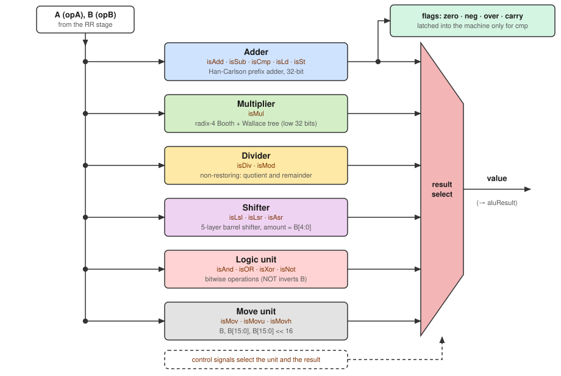
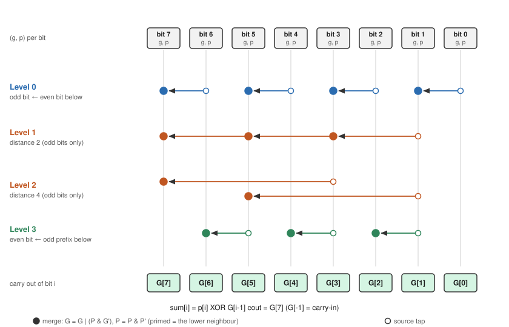
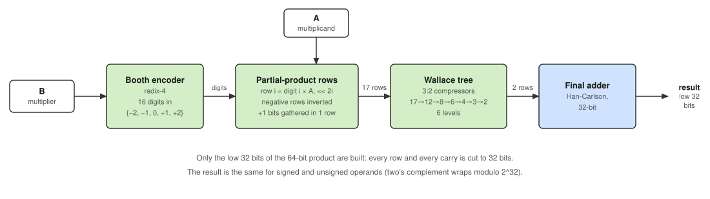
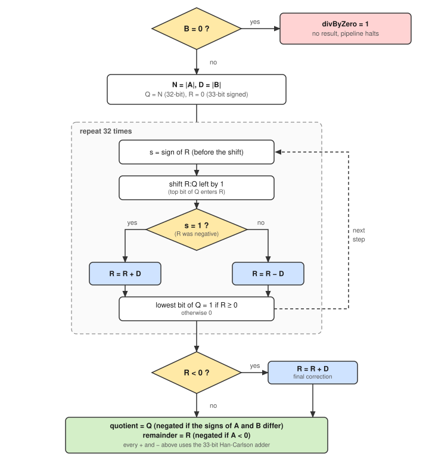
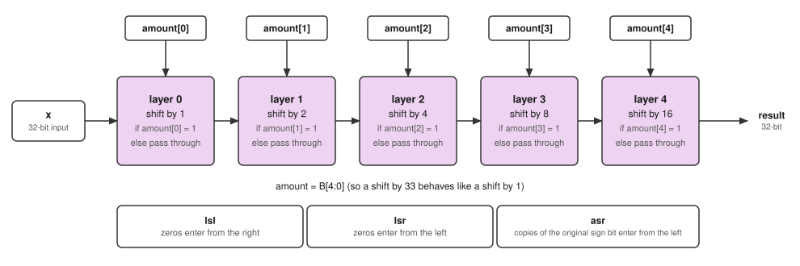

# ALU

A 32-bit, purely combinational ALU for the RISC201 simulator, called from the EX stage. It has an integer datapath and an IEEE-754 binary32 floating-point unit (FPU). Files: `include/alu.hpp`, `src/alu.cpp`.

The ALU never touches `MachineState`. It takes the control signals and two operands and returns a value plus flags.

---

## 1. Interface

```cpp
ALUResult ALU::execute(const controlsignals& s, int32_t a, int32_t b) const;
```

`a` = `opA` (`Reg[rs1]`), `b` = `opB` (immediate or `Reg[rs2]`).

| `ALUResult` field | Meaning |
|---|---|
| `value` | the result, stored by EX in `aluResult` |
| `zero`, `neg`, `over`, `carry` | adder flags (never set by the FPU) |
| `updateFlags` | `true` only for `cmp`; EX latches the flags only then |
| `divByZero` | integer `div`/`mod` with `B == 0`; EX raises a `DIV_BY_ZERO` fault |

---

## 2. Overview



The control signals select exactly one unit; the others are idle. The figure shows the integer units. The FPU sits beside them and is selected by `isFloat`.

| Signals | Unit | Computes | Flags latched? |
|---|---|---|---|
| `isAdd` | Adder | `A + B` | no |
| `isLd`, `isSt` | Adder | `A + B` (memory address) | no |
| `isSub` | Adder | `A − B` | no |
| `isCmp` | Adder | `A − B` | **yes** |
| `isMul` | Multiplier | low 32 bits of `A × B` | no |
| `isDiv` / `isMod` | Divider | quotient / remainder | no |
| `isLsl` / `isLsr` / `isAsr` | Shifter | `A` shifted by `B[4:0]` | no |
| `isAnd` / `isOR` / `isXor` | Logic | `A & B`, `A \| B`, `A ^ B` | no |
| `isNot` | Logic | `~B` | no |
| `isMov` / `isMovu` / `isMovh` | Move | `B`, `B & 0xFFFF`, `(B & 0xFFFF) << 16` | no |
| `isFloat` + `isAdd`/`isSub`/`isMul`/`isDiv` | FPU | binary32 `A+B`, `A−B`, `A×B`, `A÷B` | no |

`nop`, `ret`, `b`, `beq`, `bgt`, `bsm` and `call` never reach the ALU.

---

## 3. Integer units

### 3.1 Adder: Han-Carlson parallel-prefix

Used by `add`, `sub`, `cmp`, `ld`/`st` addresses, negation, the integer multiplier and divider, and the FPU's significand adds and rounding increment.

For every bit, compute generate `g = a & b` and propagate `p = a ^ b`. Groups of bits are merged with

```
(G, P) merged with (G', P') = ( G | (P & G'),  P & P' )      (primed = lower neighbour)
```

so carries are found in a few parallel levels instead of rippling. After the network, `G[i]` is the carry out of bit `i`.



Han-Carlson is Kogge-Stone on the odd bits only, plus one level at each end: level 0 merges each odd bit with the even bit below, then Kogge-Stone levels (distance 2, 4, 8, 16) on the odd bits, then a last level lets each even bit take the odd prefix below it. For 32 bits that is 6 levels and 80 cells (Kogge-Stone: 5 levels, 129 cells).

The carry-in is folded into bit 0, and `sum[i] = p[i] XOR (carry into bit i)`. Subtraction is `A + ~B + 1`. The adder is written for any width up to 64 bits.

This is the only carry-propagate adder in the ALU; there is no second adder design. The widths in use are 25 (rounding increment), 26 and 28 (FP near and far paths), 32 (integer datapath), 33 (divider remainder) and 48 (FP multiplier and divider). At 48 bits the network has 7 levels (1 + 5 + 1).

**Flags**

| Flag | Rule |
|---|---|
| `zero` | result is 0 |
| `neg` | bit 31 of the result |
| `carry` | carry out of bit 31 (for a subtraction, 1 means *no borrow*) |
| `over` | carry into bit 31 XOR carry out of bit 31 |

### 3.2 Multiplier: radix-4 Booth + Wallace tree (low 32 bits)



- **Booth encoding:** B is read as 16 overlapping triples `(b[2i+1], b[2i], b[2i−1])`, each giving a digit in {−2, −1, 0, +1, +2}. That gives 16 rows instead of 32.
- **Rows:** row `i` is `|digit| × A` shifted left by `2i`, cut to 32 bits. A negative row is stored inverted and a `+1` is owed at column `2i`; the owed bits form one extra row, so there are **17 rows**.
- **Wallace tree:** groups of three rows become two (full adders): `17 → 12 → 8 → 6 → 4 → 3 → 2`, 6 levels.
- **Final add:** the last two rows go through the 32-bit adder. Only the low 32 bits are built, so signed and unsigned give the same result.

### 3.3 Divider: non-restoring



One piece of hardware produces both quotient (`div`) and remainder (`mod`). Operands are made positive. A 33-bit signed partial remainder `R` starts at 0 (the extra bit keeps `2R + bit` from overflowing, even for `|INT_MIN|`). Repeat 32 times:

1. note the sign of `R`;
2. shift `R:Q` left by one (top bit of `Q` enters `R`);
3. add `D` if `R` was negative, otherwise subtract `D`;
4. set the lowest bit of `Q` to 1 if the new `R ≥ 0`, else 0.

If `R` ends negative, add `D` back once. Then restore signs: the quotient is negated when the signs of A and B differ, and the remainder takes the sign of A. Division truncates toward zero. Every add/subtract uses the adder.

| Case | Result |
|---|---|
| `B = 0` | `divByZero = 1` |
| `INT_MIN ÷ −1` | quotient wraps to `INT_MIN`, remainder 0, `over = 1` in the result (not latched) |

### 3.4 Shifter: logarithmic barrel shifter



Five layers shift by 1, 2, 4, 8, 16 or pass through, according to one bit of the amount each. The amount is `B[4:0]`. `lsl` and `lsr` shift in zeros; `asr` shifts in copies of the original sign bit. The FPU reuses it for alignment.

### 3.5 Logic unit

`and`, `or`, `xor` on A and B; `not` inverts B (the assembler puts the source of `not` in the B position).

### 3.6 Move unit

| Signal | Result |
|---|---|
| `isMov` | `B` |
| `isMovu` | `B & 0xFFFF` (upper half cleared) |
| `isMovh` | `(B & 0xFFFF) << 16` (lower half cleared) |

---

## 4. Floating-point unit (IEEE-754 binary32)

### 4.1 Selection and behaviour

`r26`…`r31` are the **float registers**: ordinary 32-bit registers holding binary32 bit patterns. `isFloat` is set at decode when the instruction is `add`, `sub`, `mul` or `div` in register form and **both** `rs1` and `rs2` are float registers. Anything else (immediate form, mixed sources, `mod`, `ld`/`st`) is an integer operation on the raw bits.

- Round to nearest, ties to even; subnormals supported; bit-exact with IEEE-754 for all four operations.
- No flags, no `divByZero`, no exceptions. `x ÷ 0` returns ±Inf.
- No int↔float conversion and no float compare; `cmp` compares raw bits as integers.

| Case | Result |
|---|---|
| NaN operand | the first NaN operand, quieted |
| `Inf − Inf`, `0 × Inf`, `0 ÷ 0`, `Inf ÷ Inf` | default NaN `0x7FC00000` |
| Inf or zero operands otherwise | ±Inf or ±0 as in IEEE-754 |
| `x − x` | +0 |

### 4.2 Adder / subtractor: dual-path

`fsub(a, b)` is `fadd(a, −b)`. The operand with the larger exponent is X, `d = eX − eY`. Big alignment and big normalisation shifts never both occur, so there are two paths:

| Path | Used when | Operation |
|---|---|---|
| **Far** | effective addition, or effective subtraction with `d ≥ 2` | align Y right by `d` (shifted-out bits go into a sticky bit), add or subtract on a 28-bit adder, normalise by at most 1 bit |
| **Near** | effective subtraction with `d ≤ 1` | align by at most 1 bit, subtract on a 26-bit adder, negate if negative, count leading zeros, left-shift. No sticky bit is needed |

Both paths pass a 27-bit word (24 significand bits, then guard, round, sticky) and an exponent to the shared rounding stage. Subnormals are treated as exponent 1 with no hidden bit.

### 4.3 Multiplier: Booth radix-4 + 4:2 compressors + Han-Carlson

- **Sign** = `sa XOR sb`; **exponent** = `ea + eb − 127` (+1 if the product ≥ 2); subnormal inputs are normalised first with a leading-zero count.
- **Booth radix-4** recodes the 24-bit multiplier into **13 partial products**. The `+1` of a negative row goes into the empty low columns of the next row.
- **4:2 compressor tree:** `13 → 7 → 4 → 2` rows (3 levels). A 4:2 compressor is two chained full adders with a non-rippling horizontal carry.
- **One 48-bit Han-Carlson adder** (7 levels): the same shared prefix adder as the integer datapath (§3.1), not a separate design.
- **Rounding is merged into that add.** Whether the product is ≥ 2^47 is known only after the add, so `P + 2^23` and `P + 2^22` are both prepared and the MSB of `P` selects one. The half-ulp bit rides in the tree as an extra row (14 rows, still 3 levels). A tie clears the result LSB (round to even).
- **Slow path:** if the exponent could leave `1…254`, the exact product is shifted with a sticky bit and rounded by the shared rounding stage (an extra cycle in hardware).

### 4.4 Divider: one Goldschmidt iteration + exact correction

- **Sign** = `sa XOR sb`; **exponent** = `ea − eb + 127` (−1 if the quotient is below 1); significand `q = x / y`, both in `[1, 2)`.
- **Seed:** `K ≈ 1/y` from a 64-entry ROM (one linear piece per interval of `y`), about 14 bits accurate. `N0 = x·K` and `D0 = y·K` are independent multiplies.
- **One iteration:** `eps = 1 − D0`, `N1 = N0 ± N0·|eps|`. The error is about `eps²` (< 2^-27), more than the 24 bits needed.
- **Exact-remainder correction** (makes the result correctly rounded): `Qt ≈ q·2^s` is within one unit of the true floor. The remainder `R0 = mx·2^s − Qt·my` is formed exactly, and `R0 < 0` gives `Qt − 1`, `R0 ≥ my` gives `Qt + 1`, otherwise `Qt`. The final remainder gives the sticky bit.
- **Rounding merged into the correction:** the three candidates `(Qf + 1) >> 1` for `Qf = Qt−1, Qt, Qt+1` are ready before the remainder, which only selects one. An exact tie clears the LSB.
- **Slow path:** same as the multiplier.

A division uses four significand multiplies (`x·K`, `y·K`, `N0·eps`, `Qt·my`) through the same Booth + 4:2 multiplier as `fmul`. Every 48-bit add in it (the four product adds, `eps`, `N1`, `R0`, `R0 + my`, `R0 − my`) goes through the shared Han-Carlson adder.

### 4.5 Shared pieces

- **Rounding and packing:** rounds the 27-bit word to nearest even (the `+1` uses the 25-bit adder), bumps the exponent on a carry-out, returns ±Inf for exponent ≥ 255, and stores a result without a hidden bit as a subnormal.
- **Carry-propagate adder:** the FPU has none of its own. Rounding increments, both adder paths, and the 48-bit adds of `fmul` and `fdiv` all use the integer Han-Carlson adder, at the widths listed in §3.1.
- **Leading-zero count:** a priority encoder that normalises subnormal inputs and the near-path result.

---

## 5. Flags

Only `cmp` updates the machine flags (`updateFlags`). It computes `A − B` on the integer adder and EX copies `zero`, `neg`, `over`, `carry`. Floating-point results never touch the flags.

---

## 6. Limitations

- No exception handling: integer division by zero raises a fault and the run stops.
- Only `cmp` latches flags, so `add`/`sub` overflow and `INT_MIN ÷ −1` overflow are not visible to the machine.
- No timing model: every ALU operation takes one step, whatever a real divider or the FP slow paths would take.
- The FPU reports no exception flags and has no rounding modes, `mod`, conversions or compare.